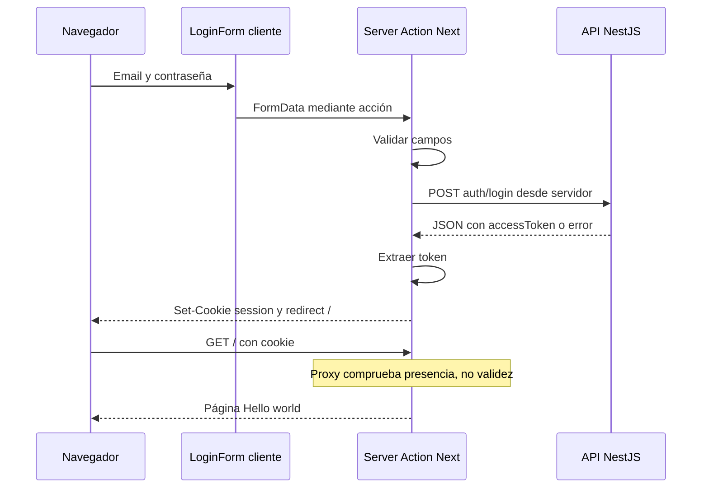

# Arquitectura actual del frontend

## Estructura y responsabilidades

```text
app/
  layout.tsx              layout raíz, idioma, fuentes y metadata
  globals.css             Tailwind, tema y estilos base
  page.tsx                inicio y formulario logout
  login/page.tsx          pantalla de acceso
  login/login-form.tsx    componente cliente del formulario
  actions/auth.ts         acciones de servidor login/logout y fetch
lib/
  session.ts              lectura, escritura y eliminación de cookie
proxy.ts                  redirección por presencia de cookie
public/                   SVGs de plantilla
```

La estructura procede de los archivos versionados; no existen carpetas de módulos de condominios, repositorios de datos, cliente API compartido, hooks personalizados, providers o stores globales.

## Componentes y límites cliente/servidor

[layout.tsx](../app/layout.tsx), [page.tsx](../app/page.tsx) y [login/page.tsx](../app/login/page.tsx) no declaran `use client`; mantienen el modelo de componentes de servidor de Next. [login-form.tsx](../app/login/login-form.tsx) sí declara `use client` y usa `useActionState` para datos del formulario, errores y pending. No consulta la API directamente desde el navegador.

[auth.ts](../app/actions/auth.ts) declara `use server`. Su función authenticate privada concentra el único fetch del proyecto. login convierte FormData a strings, valida y llama al backend; logout borra cookie. [session.ts](../lib/session.ts) usa cookies de Next y exporta createSession, getSession, deleteSession y SESSION_COOKIE. getSession existe, pero no se consume en las páginas ni en auth.ts; proxy consulta las cookies del request directamente.

No hay un contexto global del usuario ni proveedor de sesión envolviendo el árbol. El único estado de UI explícito es el del formulario; para estado compartido futuro debe evaluarse la necesidad antes de elegir una librería.

## Flujo de login actual



La secuencia presupone una API_URL correcta y respuesta satisfactoria. No incluye refresh, consulta de usuario ni roles porque no están implementados. El token solo se guarda como valor de cookie, sin wrapper de sesión firmado adicional; el propio JWT procede del backend.

## Enrutamiento y manejo de errores

[proxy.ts](../proxy.ts) considera pública exactamente `/login`. Su matcher excluye rutas api, recursos internos indicados de Next, favicon y algunas extensiones de imágenes. Redirige al login si falta cookie en ruta no pública; si hay cookie en login redirige al inicio. No decide permisos por rol ni debe utilizarse como única autorización de futuras acciones o endpoints excluidos del matcher.

Los errores de validación y credenciales vuelven como LoginState y se presentan en un párrafo con `aria-live`. Los fallos de red, configuración y respuestas inesperadas se registran en servidor y producen un mensaje genérico. `redirect('/')` está fuera del catch de autenticación. No se encontraron error boundaries propios (`error.tsx`), interceptores de respuesta ni un mecanismo global de recuperación de sesión.

## Patrones existentes y propuestas separadas

Existe separación pequeña entre UI, acciones de servidor y utilidades de cookie, con enrutamiento por archivos. No hay arquitectura Redux, MVVM, CQRS ni cliente HTTP centralizado. Crear un servicio API con manejo común de Bearer/errores o componentes de layout por rol sería trabajo futuro; no se presenta como una capa ya disponible.

La estructura puede ampliarse conservando estas responsabilidades, después de acordar sesión y permisos con el backend. Los contratos de integración y limitaciones están en [04-integracion-backend.md](04-integracion-backend.md).
